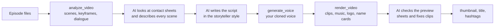

<div align="center">

# animerecap

**Turn anime episodes into finished YouTube recap videos with one command in your AI coding app.**

[](LICENSE)


```
/animerecap ~/Videos/ep01.mkv ~/Videos/ep02.mkv
```

</div>

animerecap is an AI agent skill. You give it episode files, and your AI app (Claude Code, Codex, Gemini CLI, OpenCode, Cursor, ...) produces a recap of about 20 minutes per episode. The narration is in a fixed, calm storyteller style and uses **your own cloned voice**, with **your channel logo**, **your background music** and character name cards. It also makes the thumbnail, title and hashtags.

There is no website and no extra vision API. The AI in your app looks at the frames and writes the script itself. A Python script does all the mechanical work with ffmpeg and Pillow.

## Features

- **The AI watches every scene.** Scene detection and keyframe contact sheets let it describe every shot, then write the recap in order, scene by scene.
- **A fixed storyteller style:** simple English, third person, present tense, reasons for everything, and the same closing line every time. You can copy your own reference script's voice.
- **Your cloned voice:** a Fish Audio voice-over in your own cloned voice, with free Edge TTS for test runs.
- **Your channel logo** at the bottom right of the whole video.
- **Character name cards:** the first time a character is introduced, the name appears in bold white letters at the bottom right.
- **Background music** from your own tracks, mixed quietly under the narration. A folder of tracks plays in turn, with crossfades.
- **Matched clips:** each sentence shows the scenes it talks about. Clips are at most about 5 s each, and no scene is ever reused. The original audio is muted.
- **No subtitles:** the video has no subtitle tracks and no captions.
- **A thumbnail from a real frame:** a thick yellow arrow, a bold label, a green "+99" badge and a speech bubble. It never generates new art.
- **Ready to upload:** a 1920x1080 MP4, a 1280x720 thumbnail, and the title, description and hashtags.
- **Resumable:** long steps stop safely before your app's command timeout and continue where they stopped. Editing one beat re-voices and re-renders only that beat.

## How it works



All the instructions the AI follows, including the style rules, are in [`SKILL.md`](SKILL.md). Every mechanical step is a tool in [`scripts/recap.py`](scripts/recap.py).

## Quick start (Claude Code)

1. Install the requirements: Python 3.10+, ffmpeg, and the Python packages.

   ```bash
   brew install ffmpeg            # macOS (Linux: sudo apt install ffmpeg, Windows: winget install ffmpeg)
   ```

2. Install the skill.

   ```bash
   git clone https://github.com/Priyanshu-dev525/AnimeRecap ~/.claude/skills/animerecap
   ```

   ```bash
   pip install -r ~/.claude/skills/animerecap/requirements.txt
   ```

3. Make it yours. Put `logo.png` and your music into `~/.claude/skills/animerecap/assets/`. Then just tell Claude your Fish Audio key and cloned voice id (see the next section).
4. Restart Claude Code, then run:

   ```
   /animerecap "/path/to/episode 01.mkv"
   ```

## Make it yours

### Your voice: API key and cloned voice

1. Create an API key in your [Fish Audio](https://fish.audio) account.
2. Clone your voice there, and copy the voice's id. This is the `reference_id` the API uses.
3. Give both to animerecap in any one of these ways:
   - **Tell the AI:** "My Fish Audio API key is ... and my voice id is ...". It saves them with the `configure` tool.
   - **Edit the config file:** copy [`config.example.json`](config.example.json) to `config.json` and fill in `fish_api_key` and `fish_voice_id`.
   - **Use environment variables:** set `FISH_API_KEY` and `FISH_VOICE_ID`. These override `config.json`.

`config.json` is git-ignored and readable only by you, so your key is never committed. Without a key, animerecap uses the free Edge TTS voice, which is meant for testing.

### Your channel logo

Put your logo at `assets/logo.png` (or `.webp` / `.jpg`), or tell the AI where it is. It appears at the bottom right of every frame. A PNG with a transparent background looks best.

Adjust it with `logo_size` (its width as a fraction of the video, default `0.12`) and `logo_opacity` (default `0.9`).

### Background music

Put tracks in `assets/music/` (`.mp3`, `.m4a`, `.wav`, `.flac`, `.ogg`, `.opus`), or point `music` at any file or folder. animerecap handles the mixing:

- The tracks are loudness-matched, crossfaded and looped to fit the video.
- They are mixed under the voice at `music_volume`, which defaults to `0.12`, about 18 dB quieter than the narration.
- The music fades in at the start and out at the end.

Set `music_shuffle: true` to shuffle a folder.

### Character name cards

When the story first introduces a character, the name appears in bold white letters at the bottom right, above the logo, for `name_seconds` (default 3 s). The AI handles this: it saves the character list while it studies the episode, and it marks each introduction in the script.

Turn the name cards off with `character_names: false`.

### Your style

- **`references/sample_recap.txt`:** paste your reference recap script here. The AI reads it before writing, and copies its voice.
- **`references/thumbnail_reference.webp`:** add a thumbnail whose style you want matched.

## Other AI apps (Codex, Gemini CLI, OpenCode, Cursor, ...)

1. Clone the repo anywhere, then install the requirements:

   ```bash
   git clone https://github.com/Priyanshu-dev525/AnimeRecap ~/animerecap
   ```

   ```bash
   pip install -r ~/animerecap/requirements.txt
   ```

2. Paste the contents of `SKILL.md` into the app's agent or system prompt. That is `AGENTS.md` for Codex and OpenCode, `GEMINI.md` for Gemini CLI, or a rule in `.cursor/rules/` for Cursor.
3. Replace `<skill-dir>` in the pasted text with the clone path (`~/animerecap`).
4. Ask: `/animerecap /path/to/ep01.mkv`, or "make an anime recap of /path/to/ep01.mkv".

Your app's model must be able to view images. If the app sandboxes the filesystem, set `RECAP_HOME` to a folder it can write to.

## Usage examples

```
/animerecap ~/anime/ep01.mkv
/animerecap ~/anime/ep01.mkv ~/anime/ep02.mkv ~/anime/ep03.mkv 40
Use ~/Pictures/my-logo.png as my channel logo and ~/Music/bgm as background music.
Make the music quieter and render again.
Render this one without music.
```

The length is 22 × √episodes minutes by default (at most 90), and never more than 95% of the usable footage. A trailing number sets the minutes.

## Configuration

| Setting (`config.json`) | Environment variable | Default | Meaning |
|---|---|---|---|
| `fish_api_key` | `FISH_API_KEY` | | Your Fish Audio API key |
| `fish_voice_id` | `FISH_VOICE_ID` | | Your cloned voice's id (`reference_id`) |
| `fish_model` | `FISH_MODEL` | `s1` | The Fish Audio model, sent as the `model` header |
| `edge_voice` | `EDGE_VOICE` | `en-US-GuyNeural` | The free test voice |
| `logo` | `RECAP_LOGO` | `assets/logo.*` | The channel logo image, or `"none"` |
| `logo_size` / `logo_opacity` | | `0.12` / `0.9` | The logo's width as a fraction of the video, and its opacity |
| `music` | `RECAP_MUSIC` | `assets/music/` | A music file or folder, or `"none"` |
| `music_volume` | | `0.12` | The music's level relative to the voice (0-1) |
| `music_shuffle` | | `false` | Shuffle a folder of tracks |
| `character_names` / `name_seconds` | | `true` / `3` | Show name cards, and for how many seconds |

Other environment variables:

- **`RECAP_HOME`:** the projects folder (default `~/animerecap_projects`)
- **`RECAP_CONFIG`:** another location for the config file
- **`FISH_API_URL`:** another endpoint, for example a self-hosted Fish Speech server
- **`WHISPER_MODEL`:** the model used when an episode has no English subtitles
- **`RECAP_FONT`:** a heavy font for the name cards and thumbnails
- **`RECAP_TIME_BUDGET`:** how many seconds a long tool runs before it stops cleanly (default 540)

Tool arguments override environment variables, and environment variables override `config.json`.

## Output

Everything for a project is in `RECAP_HOME/<project_id>/output/`:

| File | Contents |
|---|---|
| `recap.mp4` | 1920x1080 H.264 + AAC stereo: matched clips, narration, music, logo, name cards, no subtitles |
| `thumbnail.jpg` | 1280x720, edited from a real frame |
| `publish.txt` | The title, description and hashtags, ready to paste |
| `script.txt` / `script_table.md` | The narration, plain and as a timestamped table |
| `timeline.json` | Every beat, clip and name card, with real timestamps |

## Tools

The AI calls these for you. You can also run them yourself. Each prints JSON, and tools that make a picture also print `IMAGE: <path>`.

```bash
python scripts/recap.py tools                 # list every tool
```

```bash
python scripts/recap.py help configure        # details for one tool
```

```bash
python scripts/recap.py check_setup
```

```bash
python scripts/recap.py configure '{"music_volume": 0.1}'
```

| Tool | What it does |
|---|---|
| `check_setup` / `configure` | Checks the environment; saves your key, cloned voice, logo, music and name-card options |
| `inspect_video` / `suggest_length` | Tracks, subtitles and chapters; the target length (190 spoken words per minute) |
| `analyze_video` | Scene detection (`gt(scene,0.3)`), keyframes, and English dialogue from subtitles or Whisper |
| `get_contact_sheet` / `get_scene_detail` | Grids of keyframes labelled with scene ids and times; one large frame |
| `save_descriptions` / `set_content_range` | What each scene shows (credits are never used); trimming recaps and previews |
| `save_notes` / `get_notes` / `get_scenes_text` | Story notes and character names, a progress status, and the scenes as text |
| `save_script` / `update_beats` | Narration beats, checked for style, pacing, scene order and footage |
| `generate_voice` | One mp3 per beat with Fish Audio or Edge, cached by text |
| `render_video` | Clips, narration, music, logo, name cards, and `timeline.json` |
| `get_preview_sheet` / `get_timeline` | What each beat shows; real MM:SS timestamps |
| `get_thumbnail_candidates` / `make_thumbnail` | The best frames, then the thumbnail |
| `save_publish_info` / `list_projects` | The title, description and hashtags; the list of projects |

## Troubleshooting

- **Run `check_setup` first.** It shows what is missing, and which of your settings are active.
- **A long step times out:** run the same command again. Finished work is cached.
- **No English dialogue:** put an `.srt` file next to the episode, or `pip install faster-whisper`. Image-based subtitles (PGS) cannot be read.
- **Fish Audio errors:** 401 means a wrong API key, 402 means you are out of credits, and other errors usually mean the voice id or `fish_model` needs checking.
- **The music is too loud or too quiet:** set `music_volume` (try `0.08` or `0.18`), then render again. Only the final mix is redone.
- **Hardcoded subtitles in your clips:** they are burned into the source picture. Use raw or soft-subbed releases.

## Copyright

The clips in a recap are copyrighted footage owned by the anime's studio or licensor. Uploading recaps can bring Content ID claims, demonetization or strikes. Only use music you have the rights to (royalty-free, or licensed for YouTube). Make sure your use is allowed before you publish. animerecap never generates new art: thumbnails are edited real frames.

## License

[MIT](LICENSE)
